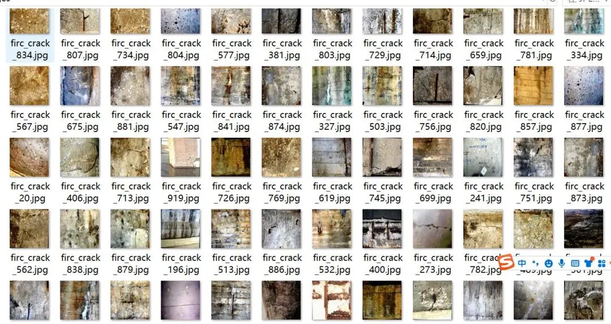
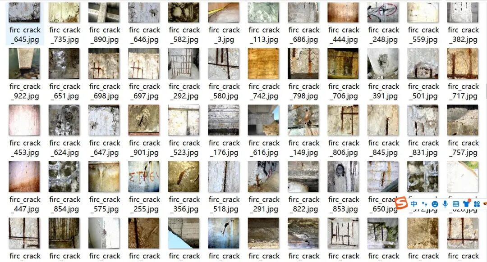
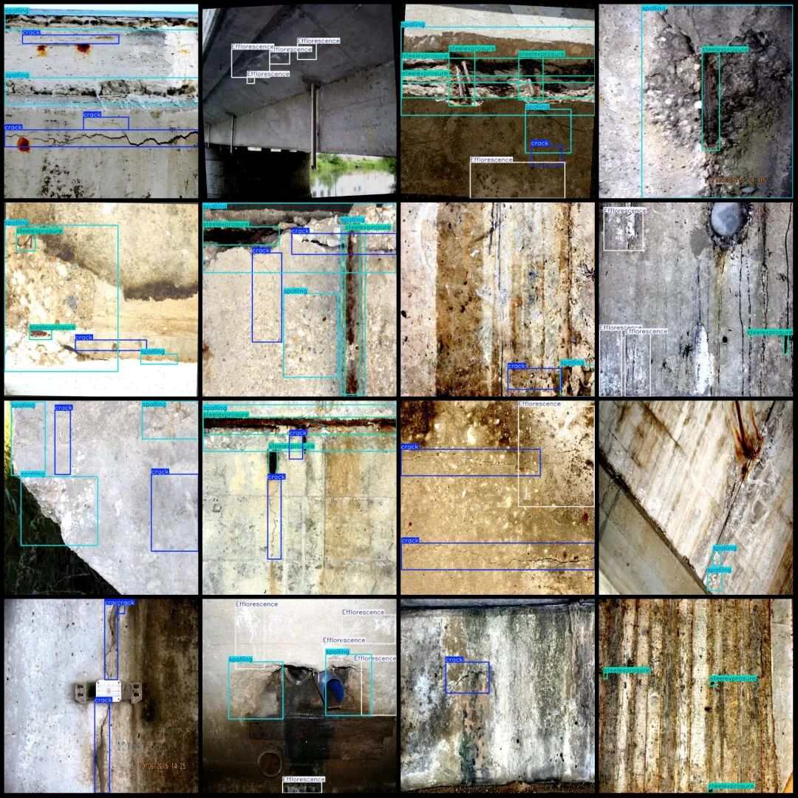

# Bridge Crack Corrosion Water Dam Building Structures Brine Stain Detection Dataset VOC+YOLO format 954 images 6 categories

Note: In the dataset, there are a small number of enhanced images mainly rotation enhancements, approximately 850 images are original.

Dataset format: Pascal VOC format + YOLO format (txt file without split path, only contains jpg images and corresponding VOC format xml files and yolo format txt files)

Number of images (number of jpg files): 954

Number of annotations (number of xml files): 954

Number of annotations (number of txt files): 954

Label count: 6

Label category names (note that the order of categories in the Yolo format does not correspond to this, but is based on the labels folder's classes.txt): ["Efflorescence", "crack", "criticaldam", "erosion", "spalling", "steelexprosure"]

Number of boxes labeled in each category:

Efflorescence (efflorescence/weathering) frame count = 377

Crack (cracks) Frames = 1414

criticaldam (severe damage) frame count = 6

erosion (Erosion) Frame count = 14

Spalling (Pulverization) Frame Count = 1325

Steelexprosure (rebar exposure) frame count = 1892

Total frame count: 5028

Image resolution: 640x640

Using labelImg:

Annotation rules: Draw a rectangle around the category.

Important Notice: No

Special : This dataset does not guarantee the accuracy of the trained models or weight files.

Image Preview:

Annotation example:

## Payment

Here is a pay link on Stripe ( https://buy.stripe.com/3cs8yP7sY87d0vu9AB ). Please contact me lonlonago@foxmail.com after funding $89, and I will send you a complete data files , thank you!

